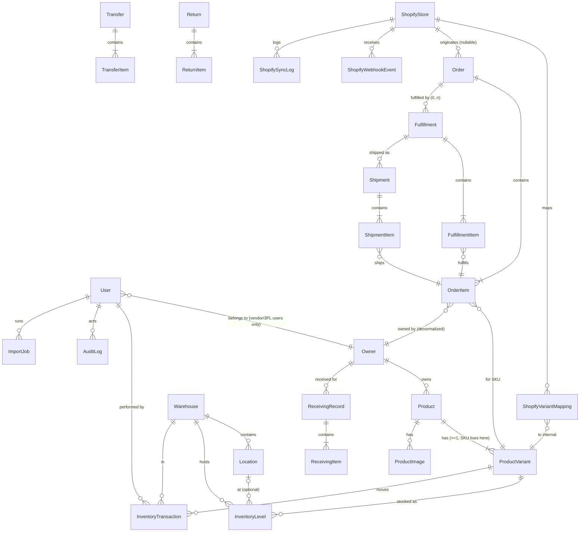

# Database Design / ERD Plan

Status: **Living design.** Rows marked *Implemented* exist in `prisma/schema.prisma` and are
migrated (Phase 1: User, AuditLog; Phase 2: Owner, User.ownerId, DELETED status; Phase 3: catalog, warehouses, inventory engine, receiving, transfers; Phase 4: orders, fulfilments, shipments, returns, order events, import jobs). Everything else
is the agreed plan for Phases 3+ and is refined when implemented.

---

## 1. ERD (core relationships)

## 2. Entities

### Identity & ownership

| Entity | Key fields | Constraints / notes |
|---|---|---|
| **User** | firebaseUid (unique), email (unique), name, role `ADMIN\|WAREHOUSE\|SALES\|VENDOR\|THREEPL_CLIENT`, status `ACTIVE\|DISABLED\|BANNED\|DELETED`, ownerId (nullable FK, `onDelete: Restrict`), phone, notes, lastLoginAt, deletedAt, deletedEmail | **Implemented (Phase 1–2).** CHECK `User_owner_role_check`: portal roles ⇔ ownerId NOT NULL. Delete = soft delete + e-mail tombstone (D-037). |
| **Owner** | type `VENDOR\|THREEPL_CLIENT`, code (unique), businessName, contactName, email, phone, addressLine1/2, city, state, postalCode, country, notes, status `ACTIVE\|INACTIVE` | **Implemented (Phase 2).** The single ownership anchor (D-003). Never hard-deleted; INACTIVE locks out its users. |

### Catalog

| Entity | Key fields | Constraints / notes |
|---|---|---|
| **Product** | ownerId (FK, **NOT NULL**, Restrict), name, category, description, status `ACTIVE\|ARCHIVED`, notes | **Implemented (Phase 3).** Ownership rule enforced by non-null FK; owner change blocked once inventory history exists. |
| **ProductVariant** | productId (FK), **sku (globally UNIQUE)**, name, barcode, price/cost Decimal(12,2), currency (`USD`), status, isDefault | **Implemented (Phase 3).** All inventory rows reference the variant (D-004, D-005). Variants with history are archived, never deleted. |
| **ProductImage** | productId (FK, Cascade), variantId?, cloudinaryPublicId (unique), url, width, height, position, alt | **Implemented (Phase 3).** Cloudinary IDs/URLs only; signed direct uploads. |

### Warehouse & inventory

| Entity | Key fields | Constraints / notes |
|---|---|---|
| **Warehouse** | code (unique), name, address, notes, status `ACTIVE\|INACTIVE` | **Implemented (Phase 3).** Deactivation requires zero stock. |
| **Location** | warehouseId (FK), label, zone, rack, shelf, bin, isDefault, isActive, notes | **Implemented (Phase 3).** Unique (warehouseId, label); one default per warehouse (partial unique index); every warehouse has `MAIN` (D-043). |
| **InventoryBalance** | variantId, warehouseId, onHand, reserved | **Implemented (Phase 3).** Unique (variantId, warehouseId). Concurrency anchor (FOR UPDATE). CHECK `onHand ≥ 0`, `reserved ≥ 0`, `reserved ≤ onHand`. `available = onHand − reserved` computed (D-043). |
| **InventoryLevel** | variantId, warehouseId, locationId (NOT NULL), onHand | **Implemented (Phase 3).** Unique (variantId, warehouseId, locationId). CHECK `onHand ≥ 0`. Σ per warehouse = balance.onHand (service-enforced). |
| **InventoryTransaction** | variantId, ownerId, warehouseId, locationId?, type `RECEIVE\|RESERVE\|RELEASE\|SHIP\|TRANSFER_OUT\|TRANSFER_IN\|MOVE\|RETURN\|DAMAGE\|MISSING\|ADJUSTMENT`, bucket `ON_HAND\|RESERVED`, quantity (signed, ≠ 0), beforeQty, afterQty, reason, notes, userId, receivingId?, transferId?, orderId?, orderItemId?, shipmentId?, externalEventId?, createdAt | **Implemented (Phase 3).** Append-only. Order/shipment FKs are added in Phase 4. |
| **ReceivingRecord / ReceivingItem** | reference, ownerId, warehouseId, receivedAt, userId, notes / variantId, locationId, quantity (> 0) | **Implemented (Phase 3).** Posted immediately; generates RECEIVE rows in the same transaction. |
| **Transfer / TransferItem** | reference, sourceWarehouseId, destWarehouseId, status `PENDING\|COMPLETED\|CANCELLED`, createdById, completedById, dates / variantId, quantity, sourceLocationId, destLocationId? | **Implemented (Phase 3).** TRANSFER_OUT at creation, TRANSFER_IN at completion or back to source on cancel (D-044). |
| **Return / ReturnItem** | orderId?, ownerId, warehouseId, receivedAt, userId, notes / orderItemId?, variantId, qty, condition `SELLABLE\|DAMAGED` | Sellable → restock; damaged → damage event. |

### Orders & fulfillment

| Entity | Key fields | Constraints / notes |
|---|---|---|
| **Order** | orderNumber (sequence from 1001, unique), source `MANUAL\|CSV_IMPORT\|SHOPIFY\|THREEPL_PORTAL`, sourceRef, shopifyStoreId?, shopifyOrderId?, shopifyOrderName?, shopifyFinancialStatus?, shopifyFulfillmentStatus?, shopifyUpdatedAt?, shopifyCancelledAt?, status, fulfillmentStatus (derived), financialStatus, invoiceReference, needsAttention(+Reason), currency, subtotal/discountTotal/taxTotal/shippingTotal/total, shippingMethod, customer + ship-to snapshot columns, notes, tags, warehouseId?, submittedByOwnerId?, createdById?, placedAt, cancelledAt, completedAt | **Implemented (Phase 4).** **UNIQUE (shopifyStoreId, shopifyOrderId)** and **UNIQUE (source, sourceRef)** (D-013/D-047). No customer table (spec §25). |
| **OrderItem** | orderId, variantId, **ownerId (denormalised)**, position, sku/title/variantTitle snapshots, quantity, unitPrice, discount, tax, currency, requiresShipping, warehouseId?, reservedQty, shippedQty, returnedQty, cancelledQty, shopifyLineItemId?, shopifyVariantId? | **Implemented (Phase 4).** Owner on the line (D-009). CHECK: shipped + cancelled ≤ quantity, reserved ≤ remaining, returned ≤ shipped. |
| **Fulfillment / FulfillmentItem** | orderId, warehouseId, status `PICKING\|PACKED\|SHIPPED\|CANCELLED`, type `MANUAL\|EXTERNAL`, shopifyStoreId?, shopifyFulfillmentId?, assignedToId?, createdById, timestamps / fulfillmentId, orderItemId, quantity, locationId? | **Implemented (Phase 4).** **UNIQUE (shopifyStoreId, shopifyFulfillmentId)**. Pickable = ordered − shipped − cancelled − in open fulfilments. |
| **Shipment / ShipmentItem** | orderId, fulfillmentId (unique), status `PENDING\|SHIPPED\|IN_TRANSIT\|DELIVERED\|RETURNED`, carrier, service, trackingNumber, trackingUrl, shippedAt, deliveredAt, shopifySyncedAt?, notes, createdById / shipmentId, orderItemId, quantity | **Implemented (Phase 4).** One shipment per fulfilment; many per order. No courier API needed. |
| **Return / ReturnItem** | orderId, warehouseId, status `RECEIVED\|INSPECTED`, reference, reason, notes, receivedAt/By, inspectedAt/By / returnId, orderItemId, variantId, ownerId, quantity, condition `SELLABLE\|DAMAGED`?, locationId?, inspectionNotes | **Implemented (Phase 4).** Stock changes only at inspection (D-047). |
| **OrderEvent** | orderId, type, message, data (json), userId?, externalEventId?, createdAt | **Implemented (Phase 4).** Order history; `externalEventId` = replay guard for integrations. |
| **ImportJob** | type, status `PREVIEW\|COMPLETED\|FAILED\|DISCARDED`, fileName, detectedFormat, counts, payload (preview json), options, result, createdById, timestamps | **Implemented (Phase 4).** Upload → preview → confirm → results; failed-row report (D-046). |

### Shopify integration

| Entity | Key fields | Constraints / notes |
|---|---|---|
| **ShopifyStore** | name, shopDomain (unique), encryptedAccessToken, webhookSecret (encrypted), apiVersion, status, inventoryPublishRule (per-store publishing config), locationMapping (Shopify location ↔ internal warehouse) | Tokens AES-256-GCM encrypted (D-017). |
| **ShopifyVariantMapping** | storeId, shopifyProductId, shopifyVariantId, shopifyInventoryItemId, variantId (internal FK), lastSyncedAt | Unique (storeId, shopifyVariantId). One internal variant ↔ many stores. |
| **ShopifyWebhookEvent** | storeId, webhookId, topic, status `RECEIVED\|PROCESSED\|FAILED\|SKIPPED_DUPLICATE`, error, retryCount, receivedAt, processedAt, payload (jsonb) | **UNIQUE (storeId, webhookId)** — event-level idempotency (D-013). |
| **ShopifySyncLog** | storeId, direction `INBOUND\|OUTBOUND`, entityType, externalId, internalId, operation, status `SUCCESS\|FAILED\|NEEDS_ATTENTION`, previousValue, newValue, errorMessage, retryCount, createdAt | Admin-readable failure reporting (spec §44). |

### Platform

| Entity | Key fields | Constraints / notes |
|---|---|---|
| **ImportJob** | type `PRODUCTS\|ORDERS\|INVENTORY\|...`, direction `IMPORT\|EXPORT`, fileName, status, totalRows, successCount, failedCount, duplicateCount, errorReport (jsonb), userId, createdAt | Import/export history + downloadable error reports (spec §46/§53). |
| **AuditLog** | userId, action, entityType, entityId, oldValues (jsonb), newValues (jsonb), createdAt | Append-only (spec §51). |

## 3. How the schema enforces the critical business rules

| Rule (spec) | Enforcement |
|---|---|
| SKU → exactly one owner (§5) | `Product.ownerId NOT NULL` + variant belongs to one product + `sku` globally unique |
| No stock overwrites (§14) | No update path to quantities except through ledger-writing service; levels checked with DB CHECK constraints |
| No negative available (§17) | Conditional `reserve` inside transaction + CHECK `reserved ≤ onHand` |
| Multi-vendor orders (§24) | `ownerId` on OrderItem, not on Order |
| Duplicate order protection (§34) | UNIQUE (shopifyStoreId, shopifyOrderId); UNIQUE (storeId, webhookId); externalEventId on inventory transactions |
| Statuses not combined (§28) | Three separate fields/entities |
| Partial fulfillment (§29) | FulfillmentItem/ShipmentItem quantities at line level; counters on OrderItem |
| Audited adjustments (§20) | beforeQty/afterQty + reason + user required on ADJUSTMENT transactions |

## 4. Indexing plan (initial)

- `ProductVariant.sku` (unique), `Product.ownerId`
- `InventoryLevel (variantId, warehouseId, locationId)` unique; `warehouseId`
- `InventoryTransaction (variantId, createdAt)`, `(ownerId, createdAt)`, `(orderId)`
- `Order (shopifyStoreId, shopifyOrderId)` unique; `(status)`, `(createdAt)`, `orderNumber` unique
- `OrderItem (orderId)`, `(ownerId)`, `(variantId)`
- `ShopifyWebhookEvent (storeId, webhookId)` unique
- `ShopifySyncLog (storeId, createdAt)`, `(status)`
- `AuditLog (entityType, entityId)`, `(userId, createdAt)`

All list pages are paginated server-side; no unbounded queries.
